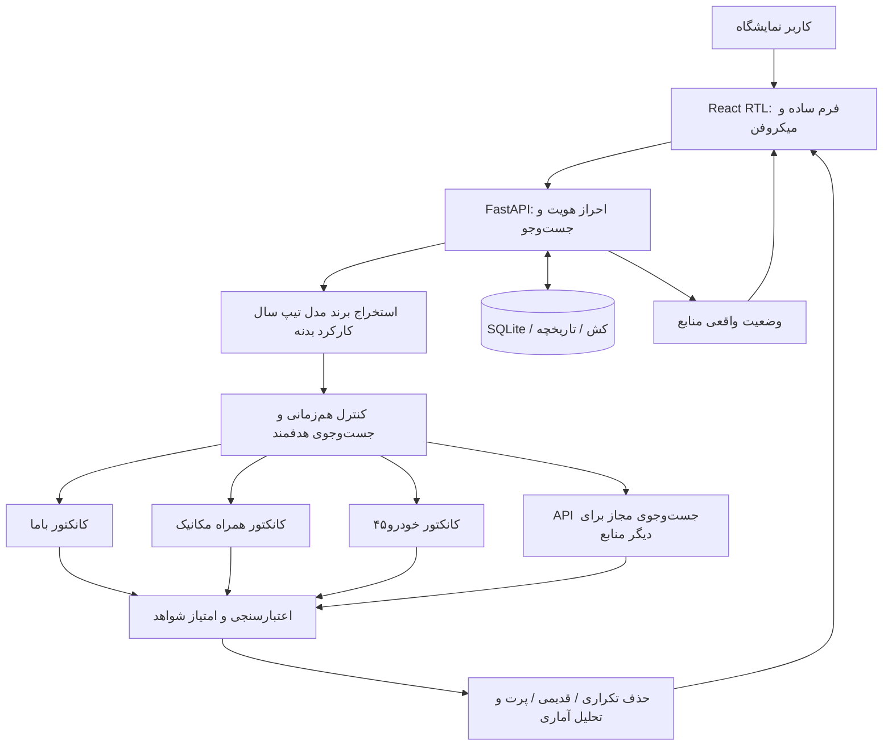
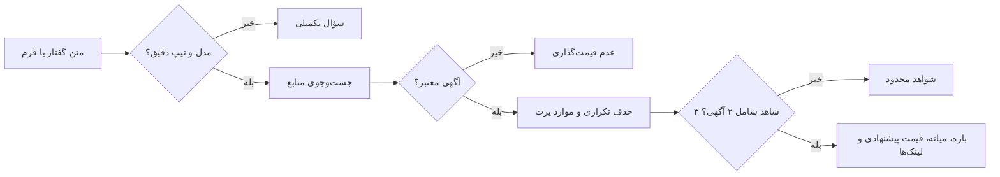

# DAVOUDI CAR — v24 Quality & Security Release Candidate

سامانه فارسی و راست‌به‌چپ هوش بازار خودرو برای نمایشگاه داودی؛ شامل ثبت مشخصات دستی/گفتاری، جست‌وجوی چندمنبعی، اعتبارسنجی قیمت و گزارش مدیریتی مبتنی بر **شواهد واقعی**.

> **وضعیت:** نسخه ۲۴ از نظر تست‌های خودکار آفلاین بررسی شده، اما **تأیید نهایی انتشار عمومی** منوط به ساخت Docker، تست مرورگرهای واقعی، کلید سرویس و بررسی نمونه‌های زنده بازار است. هیچ برآورد قیمت بدون تأیید مشخصات آگهی مبنای معامله قطعی قرار نگیرد.

## چه چیزی در v24 تغییر کرده است؟

- اصلاح استخراج قیمت: کارمزد، اقساط و هزینه انتقال دیگر قیمت خودرو محسوب نمی‌شوند. ابهام قیمت باعث «نامشخص» می‌شود نه عدد حدسی.
- اصلاح کارکرد: «مدل ۱۴۰۳ کارکرد ۵۰ هزار» برابر ۵۰٬۰۰۰ کیلومتر است، نه ۱۴۰۳ کیلومتر.
- تفکیک سخت‌گیرانه فیدلیتی پرایم، پرستیژ و الیت؛ تیپ نامشخص برای استعلام تیپ دقیق پذیرفته نمی‌شود.
- تفکیک وضعیت بدنه سالم، رنگ‌شده، تعویضی، ضربه‌خورده و تصادفی؛ رد موارد ناسازگار.
- «تحویل فوری» دیگر مترادف صفرکیلومتر نیست. صفر یا کارکرده بودن باید مستند باشد.
- افزودن محدودیت تلاش ناموفق ورود بر اساس IP (در هر پردازش)، پیام 429 و کنترل نشست.
- جست‌وجوها حداکثر در ۳ ظرفیت موازی اجرا می‌شوند؛ جست‌وجوی هر دامنه جدا با کنترل timeout و گزارش خطا.
- استفاده از JSON-LD در صفحات عمومی آگهی برای قیمت، تاریخ واقعی انتشار و کارکرد، در صورت وجود؛ هیچ داده ساختگی ایجاد نمی‌شود.
- حداکثر سن نتیجه پشتیبان ذخیره‌شده محدود شده است؛ نمایش `stale` در پاسخ.
- رابط واکنش‌گرا با پیام پیشرفت واقعیِ بررسی منابع، نمایش خطای قابل فهم، گزارش مدیریتی و حالت کاهش حرکت.
- عدم نمایش آگهی‌های حذف‌شده به‌دلیل قیمت پرت در نتایج معتبر.

## معماری کلی



## مسیر پردازش و کنترل خروجی



## فایل‌های اصلی

| مسیر | نقش |
|---|---|
| `backend/main.py` | API، مدیریت جست‌وجو، کش و تشخیص گفتار |
| `backend/safety_v24.py` | استخراج امن قیمت و کیلومتر و کنترل بدنه، رنگ و تیپ |
| `backend/market_intelligence.py` | اعتبار شواهد، تکراری‌ها، قدمت و تحلیل آماری |
| `backend/connectors/` | کانکتورهای مجاز داده عمومی و JSON-LD |
| `backend/vehicle_nlp.py` | نام‌های جایگزین گفتاری فارسی/انگلیسی |
| `frontend/src/main.jsx` | تجربه کاربری و داشبورد React |
| `frontend/src/style.css` | طراحی واکنش‌گرا و دسترس‌پذیر |
| `docs/RELEASE_V24.md` | جزئیات تغییرات، تست‌ها و محدودیت‌ها |
| `.github/workflows/ci.yml` | تست backend، syntax و build فرانت‌اند و Docker |

## API های مهم

| Method | Route | توضیح |
|---|---|---|
| GET | `/api/health` | نسخه و سلامت process |
| GET | `/api/readiness` | دسترسی پایگاه داده و وضعیت تنظیمات منابع |
| POST | `/api/login` | ورود محدودشده در برابر تلاش مکرر |
| POST | `/api/parse-voice` | استخراج مشخصات خودرو از متن |
| POST | `/api/search` | استعلام و اعتبارسنجی قیمت |
| GET | `/api/search-progress/{request_id}` | وضعیت واقعی بررسی منابع؛ نیازمند نشست معتبر |
| GET | `/api/history` | تاریخچه استعلام‌ها |
| POST | `/api/compare` | مقایسه گزارش‌ها |

در `/api/search` یک `request_id` تصادفی ۱۶ تا ۶۴ نویسه‌ای برای نمایش پیشرفت بفرستید. خروجی `response_ms` مدت پردازش سرور برای جست‌وجوی جدید را نشان می‌دهد.

## اجرای محلی و Liara

```bash
cp .env.example .env
# کلیدها/رمزهای واقعی را فقط محلی یا در Liara تنظیم کنید

docker build -t davoodi-car:v24 .
docker run --rm -p 8000:8000 --env-file .env davoodi-car:v24
```

- `ADMIN_PASSWORD` و `SESSION_SECRET` (حداقل ۳۲ نویسه) اجباری هستند.
- کلید `AVALAI_API_KEY` برای fallback جست‌وجوی مبتنی بر سرویس خارجی لازم است؛ نبود آن باید به‌صورت محدودیت منبع گزارش شود.
- `DB_PATH` باید روی فضای پایدار Liara باشد؛ SQLite با چند replica نیازمند معماری پایگاه‌داده مشترک است.
- `MAX_CONCURRENT_SEARCHES=3`، `MAX_STALE_AGE_SECONDS=3600` و `MAX_DOMAIN_REQUESTS=6` قابل تنظیم‌اند.
- رمزها، داده‌های مشتری و `.env` را در GitHub منتشر نکنید.

## اجرای تست‌ها

```bash
cd backend
python test_v21_market_fix.py
python test_v22_intelligence.py
python test_v23_quality.py
python test_v24_safety.py
cd ..
node qa/test_frontend.cjs
cd frontend && npm install && npm run build
```

## مرز اعتبار و محدودیت‌ها

آزمون‌های آفلاین قیمت‌های واقعی روز بازار را اثبات نمی‌کنند. برخی کانکتورها به ساختار HTML سایت‌های ثالث وابسته‌اند و با تغییر ساختار یا ضدبات از کار می‌افتند. هیچ CAPTCHA یا سامانه ورود سایت‌ها نباید دور زده شود. برای امنیت کامل چند replica، rate-limit و job progress باید به Redis/DB مشترک منتقل شوند. به‌روزرسانی GitHub و ساخت Docker به‌تنهایی به معنی تأیید تجاری یا بی‌باگ بودن سامانه نیست.
