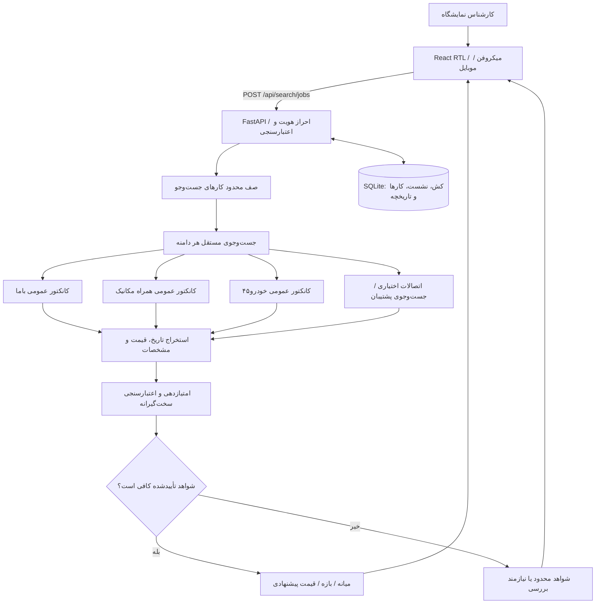

# 🚘 DAVOUDI CAR — Market Intelligence v24 (Release Candidate)

سامانه فارسی و راست‌به‌چپ استعلام قیمت خودرو برای کارکنان نمایشگاه اتومبیل داودی. نسخه ۲۴ بر **صحت شواهد قیمت، رفع خطاهای گفتاری، امنیت ورود، جست‌وجوی موازی با پیشرفت واقعی، و تجربه کاربری موبایل** متمرکز است.

> **وضعیت تحویل:** نسخه ۲۴ یک **Release Candidate برای استقرار آزمایشی Liara** است، نه تأیید «بدون باگ» یا قیمت لحظه‌ای. تست‌های آفلاین و آزمون محدود Chromium موفق بوده‌اند؛ ساخت کامل Docker/React، کیفیت آگهی‌های زنده و استقرار Liara در این محیط تأیید نشده‌اند. **هر قیمت قبل از معامله باید با لینک منبع و مشخصات خودرو توسط کارشناس کنترل شود.**

## قابلیت‌های v24 و منطق داده

| بخش | رفتار |
|---|---|
| تشخیص خودرو | فارسی/انگلیسی، نام‌های مترادف، سال شمسی/میلادی، تیپ، کارکرد، وضعیت صفر/کارکرده |
| استخراج قیمت | جداسازی قیمت کل از کارمزد، ودیعه و اقساط؛ در ابهام، عدم تولید عدد |
| تطبیق آگهی | بررسی مدل، تیپ، سال، گیربکس، کارکرد، بدنه و تاریخ واقعی انتشار |
| اعتبارسنجی | مقاله‌ها به قیمت اضافه نمی‌شوند؛ آگهی قدیمی، تکراری، پرت و مشخصات نامعلوم رد/برای بازبینی نگهداری می‌شود |
| آمار | حداقل ۳ شاهد تأییدشده شامل حداقل ۲ آگهی فروش از ۲ دامنه مستقل برای «برآورد بازار» |
| جست‌وجوی موازی | صف محدود وظایف + وضعیت واقعی منابع از API؛ دادهٔ کش تازه یا قدیمی با برچسب مشخص |
| امنیت | محدودیت تلاش ورود، نشست تصادفی امضاشده، خروج و ابطال نشست، محدودیت نرخ جست‌وجو |
| رابط کاربر | ورودی کوتاه، انتخاب فیلدهای ضروری، گزارش مدیریتی، لینک شواهد و «نیازمند بررسی»، موبایل/RTL |

## دیاگرام معماری



## راه‌اندازی محلی / Liara

۱. از ریشه پروژه فایل `.env.example` را برای محیط خود کپی کنید؛ **هرگز `.env` یا کلید واقعی را در GitHub قرار ندهید.**
۲. متغیرهای اجباری: `ADMIN_PASSWORD` و `SESSION_SECRET` (حداقل ۳۲ نویسه). برای استفاده از جست‌وجوی پشتیبان می‌توان `AVALAI_API_KEY` را فعال کرد. `DB_PATH` باید در فضای ذخیره‌سازی **پایدار** باشد.
۳. اجرای Docker:

```bash
docker build -t davoodi-car:v24 .
docker run --rm -p 8000:8000 --env-file .env davoodi-car:v24
```

۴. برنامه: `http://localhost:8000`، سلامت: `GET /api/health`، نسخه مورد انتظار: `24.0.0-release-candidate`.
۵. برای Liara **استقرار آزمایشی** Docker را از ریشه ZIP انجام دهید؛ مسیر محیطی `FRONTEND_DIST=/app/frontend/dist` در Dockerfile تنظیم شده است. از دست‌دادن فایل دیتابیس باعث از دست رفتن تاریخچه، ابطال نشست‌ها و وضعیت کارها می‌شود.

**محدودیت معماری:** اجرای وظایف فعلاً در ThreadPool داخل همان پردازش انجام می‌شود. برای Liara از **یک replica با ذخیره‌سازی SQLite پایدار** استفاده کنید؛ برای چند replica یا تضمین ادامهٔ کار پس از restart باید صف خارجی (Redis/RQ/Celery) و PostgreSQL پیاده‌سازی شوند. عملیات طولانی در restart از ابتدا تکرار می‌شوند و ممکن است در ۱۵۰ ثانیه ناموفق شوند.

## تست‌ها

```bash
cd backend
python test_v21_market_fix.py
python test_v22_intelligence.py
python test_v23_quality.py
python test_v24_release.py
cd ..
node qa/test_frontend.cjs
python qa/test_static_serving_v24.py
```

اختیاری (با Playwright/Chromium نصب‌شده): `python qa/browser_voice_v24.py`. تست Chromium فقط منطق fallback گفتار را در دو اندازه صفحه بررسی می‌کند، **نه UI واقعی React**.

## ساختار پروژه

```text
backend/main.py                FastAPI، امنیت، جست‌وجو و API
backend/market_parsers.py      استخراج محافظه‌کارانه قیمت/کارکرد/بدنه
backend/market_intelligence.py ارزیابی شواهد و آمار قیمت
backend/vehicle_nlp.py        تشخیص نام خودرو
backend/connectors/           کانکتورهای عمومی منابع
frontend/src/main.jsx         رابط React
frontend/src/style.css        طراحی RTL و موبایل
qa/                           آزمون‌های فرانت و مرورگر
docs/RELEASE_V24.md            یادداشت تغییرات
docs/QA_V24.md                 نتایج آزمون و محدودیت‌ها
docs/ARCHITECTURE_V24.md       دیاگرام معماری/توالی
docs/DEPLOY_LIARA_V24.md      راهنمای استقرار
.github/workflows/ci.yml      تست Python / Node / Docker
```

## APIهای اصلی

| متد | مسیر | نقش |
|---|---|---|
| `GET` | `/api/health` | سلامت سرویس |
| `POST` | `/api/login` | ورود و دریافت نشست |
| `POST` | `/api/logout` | ابطال نشست |
| `POST` | `/api/parse-voice` | استخراج مشخصات از متن گفتار |
| `POST` | `/api/search/jobs` | آغاز استعلام غیرهم‌زمان؛ برمی‌گرداند `job_id` |
| `GET` | `/api/search/jobs/{id}` | پیشرفت، وضعیت منابع و نتیجه |
| `POST` | `/api/search` | مسیر سازگار با نسخه‌های قبلی |
| `GET` | `/api/history` | تاریخچه استعلام |

## امنیت و مسئولیت

مخزن ممکن است عمومی باشد. کلیدهای API، رمز، اطلاعات مشتری، آگهی غیرعمومی یا دیتابیس را commit نکنید. فقط از مسیرهای عمومی یا API رسمی مجاز استفاده کنید؛ به CAPTCHA و محدودیت دسترسی سایت‌ها احترام بگذارید. امتیاز کیفیت شواهد یک شاخص قاعده‌محور است و **احتمال آماری صحت قیمت نیست**.

برای مشخصات کامل توسعه، آزمون‌ها و مراحل انتشار، به فایل‌های `docs/` مراجعه کنید.
