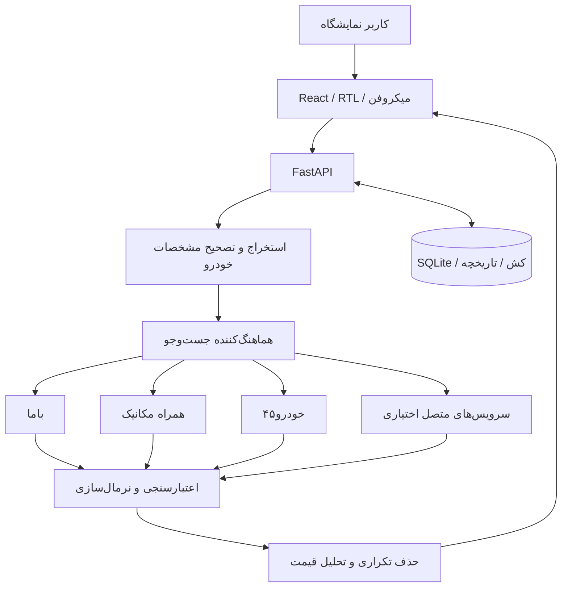
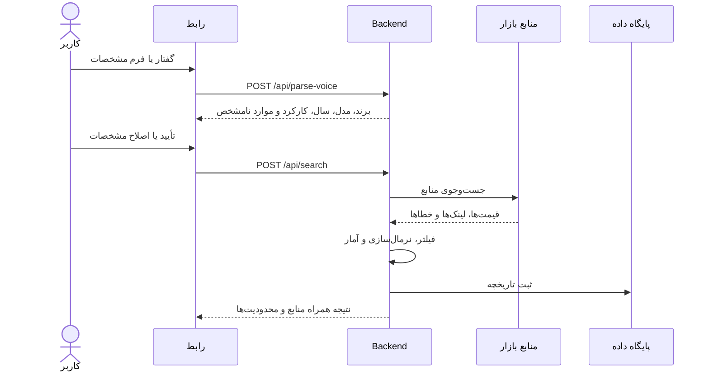

# 🚘 DAVOUDI CAR | سامانه هوش بازار خودرو

سامانه فارسی و راست‌به‌چپ برای استعلام و تحلیل قیمت خودروهای صفر و کارکرده در بازار ایران، ویژه نمایشگاه اتومبیل داودی. این مخزن برای توسعه مشترک، مستندسازی و در نهایت استقرار Docker روی Liara طراحی شده است.

> **وضعیت واقعی در ۱۲ نوامبر ۲۰۲۶:** آخرین بسته قابل دریافت **نسخه ۲۱** است. فایل ZIP کامل سورس خارج از GitHub تهیه شده، اما همه فایل‌های اصلی آن هنوز در این مخزن بارگذاری نشده‌اند. بنابراین **از روی این مخزن فعلاً نمی‌توان build قابل اتکا گرفت**. فایل‌های `backend/main.py`، `frontend/src/main.jsx`، `frontend/src/style.css` و `backend/connectors/common.py` باید با نسخه ۲۱ همگام شوند. ثبت مستندات به معنی استقرار موفق نیست.

## فهرست
- [معرفی و محدوده](#معرفی-و-محدوده)
- [قابلیت‌ها و وضعیت](#قابلیتها-و-وضعیت)
- [دیاگرام معماری](#دیاگرام-معماری)
- [جریان استعلام](#جریان-استعلام)
- [فناوری و ساختار فایل‌ها](#فناوری-و-ساختار-فایلها)
- [API](#api)
- [راه‌اندازی و Liara](#راهاندازی-و-liara)
- [کیفیت داده و امنیت](#کیفیت-داده-و-امنیت)
- [نسخه‌ها و رفع باگ](#نسخهها-و-رفع-باگ)
- [مستندات تکمیلی](#مستندات-تکمیلی)

## معرفی و محدوده
**کاربران:** مالک و کارکنان نمایشگاه؛ در مراحل بعدی امکان توسعه نسخه مراجعه‌کننده/کیوسک وجود دارد.

**ورودی:** برند، مدل، تیپ، سال شمسی یا میلادی، کارکرد، وضعیت بدنه، رنگ، گیربکس و توضیح فارسی با فرم یا گفتار.

**خروجی هدف:** قیمت‌های قابل استناد با لینک و مشخصات منبع، دامنه و آمار قیمت، و در صورت کمبود داده گزارش صریح «شواهد کافی نیست». موجودی داخلی نمایشگاه جزو MVP اصلی نیست.

## قابلیت‌ها و وضعیت
| قابلیت | شرح | وضعیت |
|---|---|---|
| رابط React فارسی RTL | جست‌وجو، ورود دستی و گفتاری، مشاهده نتیجه | در بسته ZIP نسخه ۲۱؛ سورس GitHub ناقص |
| تشخیص خودرو از گفتار | استخراج مدل، برند، سال و کارکرد | اصلاحات فیدلیتی و ۲۰۲۵ در ZIP نسخه ۲۱ آزمایش شده |
| کاتالوگ و کشف مدل‌ها | پیشنهاد مدل و ثبت شواهد | کد در بسته ZIP؛ آزمون زنده کامل نشده |
| کانکتورهای منابع | باما، همراه مکانیک، خودرو۴۵ | ماژول‌ها در GitHub؛ اتصال و عملکرد زنده تأیید نشده |
| تحلیل قیمت | نرمال‌سازی، فیلتر ارتباط و محاسبه آمار | در backend بسته؛ نیازمند آزمون واقعی منابع |
| تاریخچه و مقایسه | API و ذخیره سوابق | در بسته ZIP؛ آزمون یکپارچه لازم |
| عکس خودرو و لوگو | جست‌وجو و بانک تصویر | در بسته ZIP؛ وابسته به سرویس‌های خارجی |
| Docker و Liara | بسته‌بندی و انتشار | Dockerfile موجود؛ استقرار نسخه ۲۱ تأیید نشده |

## دیاگرام معماری


## جریان استعلام


## فناوری و ساختار فایل‌ها
- **Frontend:** React، Vite، JavaScript، CSS و رابط فارسی
- **Backend:** Python 3.12، FastAPI، Uvicorn
- **داده:** SQLite؛ مسیر دیتابیس با `DB_PATH` قابل تنظیم است
- **استقرار:** Docker چندمرحله‌ای (Node برای build و Python برای سرویس)
- **کانکتورها:** ماژول‌های مستقل دریافت اطلاعات عمومی؛ اتصال APIهای رسمی فقط با مجوز

```text
.
├── Dockerfile
├── .env.example
├── backend/
│   ├── main.py                  # در ZIP نسخه ۲۱؛ هنوز در GitHub نیست
│   ├── requirements.txt
│   └── connectors/
│       ├── common.py            # در ZIP؛ هنوز در GitHub نیست
│       ├── bama.py
│       ├── hamrah.py
│       └── khodro45.py
├── frontend/
│   ├── package.json
│   ├── index.html
│   ├── src/main.jsx             # در ZIP؛ هنوز در GitHub نیست
│   ├── src/style.css            # در ZIP؛ هنوز در GitHub نیست
│   └── public/
└── docs/
```

## API
مسیرهای موجود در `backend/main.py` بسته نسخه ۲۱:

| متد | مسیر | کارکرد |
|---|---|---|
| GET | `/api/health` | سلامت سرویس |
| POST | `/api/login` | ورود |
| POST | `/api/parse-voice` | تحلیل متن گفتار |
| POST | `/api/search` | استعلام قیمت |
| GET | `/api/history` | تاریخچه |
| GET | `/api/history/{item_id}` | جزئیات استعلام |
| POST | `/api/compare` | مقایسه |
| GET | `/api/catalog` | فهرست خودروها |
| GET | `/api/catalog/suggest` | پیشنهاد مدل |
| POST | `/api/catalog/discover` | شروع کشف خودرو |
| GET | `/api/catalog/discovery-status` | وضعیت کشف |
| GET | `/api/catalog/evidence` | شواهد مدل |
| POST | `/api/catalog/import` | واردکردن کاتالوگ |
| GET | `/api/car-image` | تصویر خودرو |
| GET | `/api/brand-logo` | لوگوی برند |
| GET | `/api/car-photo-bank` | بانک تصاویر |
| POST | `/api/car-photo-bank/{key}` | آپلود تصویر |
| GET | `/api/car-photo-file/{key}` | دریافت تصویر |

به‌جز سلامت سرویس و ورود، بیشتر مسیرها نیازمند احراز هویت هستند. قرارداد دقیق request/response باید از سورس و OpenAPI تولیدشده بررسی شود.

## راه‌اندازی و Liara
**پیش‌نیاز:** ZIP کامل نسخه ۲۱؛ مخزن فعلی GitHub به‌تنهایی کامل نیست.

۱. ZIP را استخراج کنید؛ `Dockerfile` باید در ریشه پروژه باشد.  
۲. در محیط محلی فایل `.env.example` را به `.env` کپی کنید و مقدارهای واقعی را فقط در محیط امن وارد کنید.  
۳. برای تست محلی:
```bash
docker build -t davoodi-car:v20 .
docker run --rm -p 8000:8000 --env-file .env davoodi-car:v20
```
۴. برای Liara از استقرار Docker استفاده کنید، متغیرهای محیطی را در داشبورد تعریف کنید و فضای پایدار برای `DB_PATH` در نظر بگیرید.  
۵. بعد از انتشار، `/api/health`، ورود، جست‌وجوی نمونه، گفتار و تاریخچه را بررسی کنید.

**متغیرهای مهم:** `ADMIN_PASSWORD`، `SESSION_SECRET` (حداقل ۳۲ نویسه)، `DB_PATH`، `PORT`، `AVALAI_API_KEY`، `OPENAI_API_KEY`، `OPENAI_MODEL`، `SEARCH_CACHE_TTL`، `MAX_SEARCHES_PER_HOUR`، `SEARCH_COOLDOWN` و آدرس‌های اختیاری کانکتورها. همه کلیدهای API را فقط در تنظیمات امن نگهداری کنید.

## کیفیت داده و امنیت
- قیمت باید به منبع قابل بررسی متصل باشد؛ قیمت ساختگی ممنوع.
- قیمت آگهی با قیمت معامله نهایی تفاوت دارد.
- سال میلادی و شمسی باید جداگانه تشخیص داده شوند؛ بدون تبدیل حدسی.
- عبارت «فیتیلی» می‌تواند به‌عنوان **پیشنهاد فیدلیتی** تشخیص داده شود؛ تأیید نهایی با کاربر است.
- محدودیت‌های سایت‌ها و شرایط دسترسی رعایت شود؛ CAPTCHA دور زده نشود.
- مخزن در ابتدا عمومی بوده است؛ از انتشار رمز، توکن، اطلاعات مشتری و دیتابیس خودداری کنید.

## نسخه‌ها و رفع باگ
| نسخه | تغییر |
|---|---|
| ۱۷ | کانکتورهای منابع عمومی و موتور بازار |
| ۱۸–۱۹ | اصلاح تشخیص نام «فیدلیتی» از گفتارهای متفاوت |
| ۲۰ | رفع مشکل تشخیص سال `2025` بدون واژه «مدل» و حفظ سال هنگام ذکر کارکرد |

**تست‌های تأییدشده نسخه ۲۱:** تابع `parse_voice` در محیط Python برای «خودرو فیتیلی 2025»، «فیدلیتی مدل ۲۰۲۵ کارکرد ۵۰ هزار کیلومتر» و «فیدلیتی ۱۴۰۳» سال و مدل مورد انتظار را برگردانده است. build Docker، استقرار Liara و عملکرد منابع زنده هنوز تأیید نشده‌اند.

## مستندات تکمیلی
- [معرفی پروژه](docs/PROJECT_OVERVIEW.md)
- [دیاگرام‌های کامل](docs/SYSTEM_DIAGRAMS.md)
- [وضعیت دقیق توسعه](docs/DEVELOPMENT_STATUS.md)
- [کانکتورها](docs/CONNECTORS.md)
- [رفع خطای گفتار](docs/VOICE_RECOGNITION_FIX.md)
- [معماری](docs/ARCHITECTURE.md)
- [مشارکت توسعه‌دهندگان](docs/CONTRIBUTING.md)

## گام بعدی
انتقال و همگام‌سازی کامل سورس نسخه ۲۱ در GitHub، build و تست خودکار، سپس استقرار Liara و تأیید عملی.


## نسخه ۲۱ — اصلاح موتور منابع بازار
در v21 موتور جمع‌آوری قیمت بازطراحی شد: جست‌وجوی پشتیبان به‌صورت جداگانه برای هر دامنه انجام می‌شود، صفحات مقاله/مشخصات/راهنما قبل از نمایش منبع حذف می‌شوند، و وضعیت هر سایت «نتیجه خام» و «شاهد معتبر» را جدا گزارش می‌کند.

اگر فقط ۱ یا ۲ شاهد واقعی قیمت‌دار وجود داشته باشد، سامانه آن‌ها را به‌عنوان **شواهد محدود** و بازه مشاهده‌شده نمایش می‌دهد اما میانگین بازار صادر نمی‌کند. برای ۳ شاهد معتبر یا بیشتر، حذف پرت و تحلیل آماری اجرا می‌شود.

جزئیات: [معماری موتور منابع v21](docs/MARKET_SOURCE_V21.md) و [گزارش انتشار v21](docs/RELEASE_V21.md).
