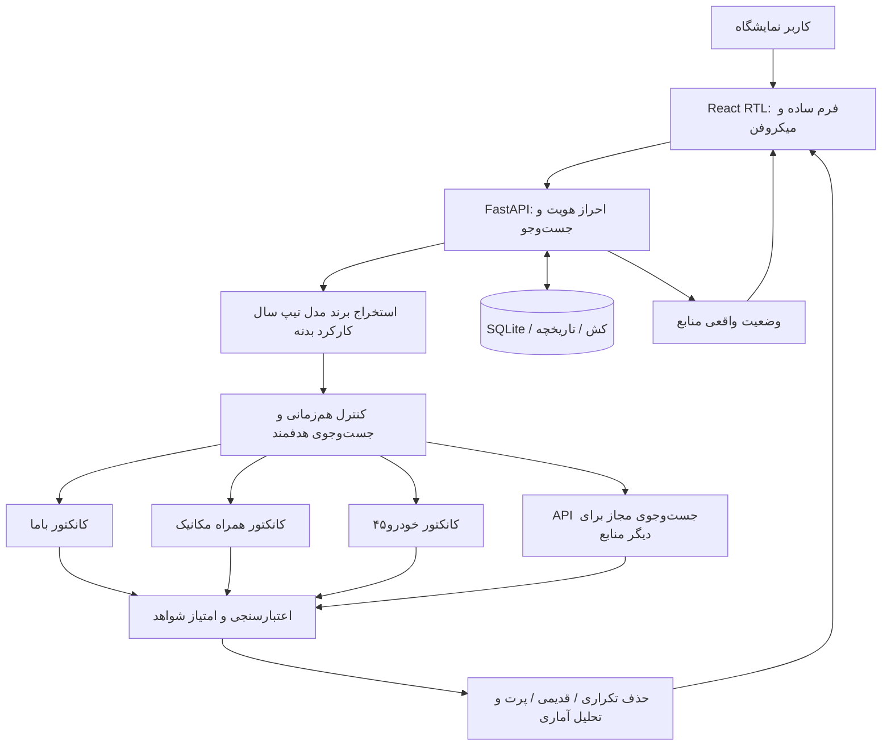
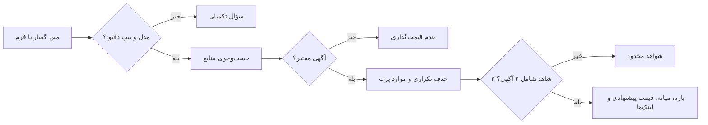

# DAVOUDI CAR — v28 Name-only Car Price Lookup

## نسخه ۲۸: فقط نام خودرو

**کاربر فقط نام خودرو را می‌نویسد یا می‌گوید.** سامانه از میان منابع بازار فعال، آگهی‌های مرتبط را جست‌وجو و قیمت‌های پیشنهادی را جداگانه بر اساس سال/تیپ/صفر یا کارکرده نمایش می‌دهد. در صورت نبود منبع معتبر، قیمت ساختگی صادر نمی‌شود.

شش منبع فعلی در سامانه پیکربندی شده‌اند (دیوار، باما، همراه مکانیک، خودرو۴۵، کارنامه، شیپور)، اما دسترسی مستقیم به همه آن‌ها تضمین نشده و دو منبع به اتصال خارجی یا جست‌وجوی تکمیلی نیاز دارند. [راهنمای v28](docs/V28_NAME_ONLY_FA.md).


**دانلود مستقیم سورس کامل v26 برای Liara:** [دریافت ZIP از GitHub](https://github.com/daneshavaran2/davoodi-car/archive/refs/heads/main.zip) · [راهنمای دانلود و نصب](docs/DOWNLOAD_V26_LIARA_FA.md). این ZIP سورس کامل است و برای اجرا باید Docker Build شود.

سامانه فارسی و راست‌به‌چپ هوش بازار خودرو برای نمایشگاه داودی؛ شامل ثبت مشخصات دستی/گفتاری، جست‌وجوی چندمنبعی، اعتبارسنجی قیمت و گزارش مدیریتی مبتنی بر **شواهد واقعی**.

> **وضعیت v26:** استخراج JS عمومی با Playwright برای ۴ منبع پیاده‌سازی شد؛ آزمون زنده صفحات ثالث، Docker در Liara و انتشار نهایی هنوز تأیید نشده‌اند. در صورت محدودیت دسترسی سایت، قیمت حدسی ارائه نمی‌شود.


## خروجی ساده قیمت حدودی

داودی‌کار برای کاربر فقط یک استعلام کوتاه و یک نتیجه ساده نشان می‌دهد:

- وقتی نمونه کافی وجود دارد: **بازه حدودی قیمت آگهی‌های مشابه** و قیمت مرکزی.
- وقتی تنها یک یا دو آگهی فروش واقعی و تأییدشده وجود دارد: **قیمت درج‌شده در همان آگهی‌ها** با هشدار «نمونه محدود»، نه تخمین قطعی بازار.
- وقتی هیچ قیمت معتبر استخراج نشده است: پیام صریح «قیمت قابل استناد دریافت نشد»؛ اطلاعات فنی خطا در بخش بازشدنی می‌ماند.
- مشخصات اصلی: مدل، تیپ، سال، کارکرد. اطلاعات تکمیلی اختیاری‌اند.

**محدودیت مهم:** ساده‌کردن نمایش قیمت به معنی موفقیت استخراج زنده نیست. برای قیمت واقعی ابتدا باید منابع در Liara با آگهی‌های معتبر آزمایش شوند و سایت‌ها دسترسی بدهند. سیستم عدد یا بازه بدون منبع نمی‌سازد.

## v27 — عیب‌یابی قابل مشاهده و استخراج محافظه‌کارانه

- **نسخه آزمایشی:** بررسی سلامت اجرای مرورگر و سازگاری استخراج برای Liara، با آزمون‌های اجباری در Docker Build.
- اصلاح لینک کوتاه دیوار، کش نتیجه صفر، جست‌وجوی عمومی‌تر مدل، قیمت عددی هر کارت و بررسی اختلاف قیمت کارت/جزئیات.
- جست‌وجوی تکمیلی اسنیپت موتور جست‌وجو را قیمت معتبر تلقی نمی‌کند؛ صفحه خود آگهی باید بررسی شود.
- علت شکست و تعداد موارد ردشده هر سایت در خروجی و رابط کاربر دیده می‌شود.
- [راهنمای تخصصی و استقرار v27](docs/V27_EXTRACTION_RELIABILITY_FA.md).
- **دقت زنده هنوز تأیید نشده است:** تا Build موفق Liara و مقایسه دستی با آگهی‌های واقعی، ادعای استخراج کامل نداریم.

## v26 — استخراج رندرشده با Playwright
- چهار کانکتور مرورگر عمومی: دیوار، باما، همراه مکانیک و خودرو۴۵ (مرجع).
- قیمت و کارکرد از کارت هر آگهی و صفحه جزئیات، نه متن همه آگهی‌ها در یک صفحه.
- تفکیک قیمت خودرو از کارمزد و اقساط؛ استفاده از JSON-LD و تاریخ واقعی انتشار در صورت موجود بودن.
- تصویر Docker حاوی Chromium؛ محدودیت حافظه و سقف مرورگرها؛ خودداری از دورزدن 403/429/CAPTCHA.
- تست آفلاین extractor و اجرای JavaScript در Chromium با صفحه نمونه؛ **بدون تأیید live منابع**.
- [راهنمای فنی Playwright و برنامه انتشار](docs/PLAYWRIGHT_MARKET_V26_FA.md).

## v25 — نتیجه در یک نگاه
- کارت اولیه با برآورد مبتنی بر شاهد یا پیام صریح «قیمت قابل اتکا نیست»؛ اعداد هرگز توسط مدل زبانی تولید نمی‌شوند.
- بازه، تعداد آگهی واقعی، تعداد منابع، کیفیت داده، زمان بررسی و حداکثر دو لینک مستند.
- داده ناکافی، وضعیت صفر/کارکرده نامشخص و کش قدیمی هرکدام پیام و اقدام جدا دارند.
- گزارش طولانی، جدول و نمودار در بخش بازشدنی قرار گرفته‌اند تا کاربر نتیجه اصلی را سریع متوجه شود.
- [راهنمای تخصصی AI و سنجش تجربه ۳ثانیه‌ای](docs/AI_AND_3SECOND_UX_V25.md).
- اجرای تست کارت نتیجه: `node qa/test_v25_quick_glance.mjs`.

## چه چیزی در v24 تغییر کرده است؟

- اصلاح استخراج قیمت: کارمزد، اقساط و هزینه انتقال دیگر قیمت خودرو محسوب نمی‌شوند. ابهام قیمت باعث «نامشخص» می‌شود نه عدد حدسی.
- اصلاح کارکرد: «مدل ۱۴۰۳ کارکرد ۵۰ هزار» برابر ۵۰٬۰۰۰ کیلومتر است، نه ۱۴۰۳ کیلومتر.
- تفکیک سخت‌گیرانه فیدلیتی پرایم، پرستیژ و الیت؛ تیپ نامشخص برای استعلام تیپ دقیق پذیرفته نمی‌شود.
- تفکیک وضعیت بدنه سالم، رنگ‌شده، تعویضی، ضربه‌خورده و تصادفی؛ رد موارد ناسازگار.
- «تحویل فوری» دیگر مترادف صفرکیلومتر نیست. صفر یا کارکرده بودن باید مستند باشد.
- افزودن محدودیت تلاش ناموفق ورود بر اساس IP (در هر پردازش)، پیام 429 و کنترل نشست.
- جست‌وجوها حداکثر در ۳ ظرفیت موازی اجرا می‌شوند؛ جست‌وجوی هر دامنه جدا با کنترل timeout و گزارش خطا.
- استفاده از JSON-LD در صفحات عمومی آگهی برای قیمت، تاریخ واقعی انتشار و کارکرد، در صورت وجود؛ هیچ داده ساختگی ایجاد نمی‌شود.
- حداکثر سن نتیجه پشتیبان ذخیره‌شده محدود شده است؛ نمایش `stale` در پاسخ.
- رابط واکنش‌گرا با پیام پیشرفت واقعیِ بررسی منابع، نمایش خطای قابل فهم، گزارش مدیریتی و حالت کاهش حرکت.
- عدم نمایش آگهی‌های حذف‌شده به‌دلیل قیمت پرت در نتایج معتبر.

## معماری کلی



## مسیر پردازش و کنترل خروجی



## فایل‌های اصلی

| مسیر | نقش |
|---|---|
| `backend/main.py` | API، مدیریت جست‌وجو، کش و تشخیص گفتار |
| `backend/safety_v24.py` | استخراج امن قیمت و کیلومتر و کنترل بدنه، رنگ و تیپ |
| `backend/market_intelligence.py` | اعتبار شواهد، تکراری‌ها، قدمت و تحلیل آماری |
| `backend/connectors/` | کانکتورهای مجاز داده عمومی و JSON-LD |
| `backend/vehicle_nlp.py` | نام‌های جایگزین گفتاری فارسی/انگلیسی |
| `frontend/src/main.jsx` | تجربه کاربری و داشبورد React |
| `frontend/src/style.css` | طراحی واکنش‌گرا و دسترس‌پذیر |
| `docs/RELEASE_V24.md` | جزئیات تغییرات، تست‌ها و محدودیت‌ها |
| `.github/workflows/ci.yml` | تست backend، syntax و build فرانت‌اند و Docker |

## API های مهم

| Method | Route | توضیح |
|---|---|---|
| GET | `/api/health` | نسخه و سلامت process |
| GET | `/api/readiness` | دسترسی پایگاه داده و وضعیت تنظیمات منابع |
| POST | `/api/login` | ورود محدودشده در برابر تلاش مکرر |
| POST | `/api/parse-voice` | استخراج مشخصات خودرو از متن |
| POST | `/api/search` | استعلام و اعتبارسنجی قیمت |
| GET | `/api/search-progress/{request_id}` | وضعیت واقعی بررسی منابع؛ نیازمند نشست معتبر |
| GET | `/api/history` | تاریخچه استعلام‌ها |
| POST | `/api/compare` | مقایسه گزارش‌ها |

در `/api/search` یک `request_id` تصادفی ۱۶ تا ۶۴ نویسه‌ای برای نمایش پیشرفت بفرستید. خروجی `response_ms` مدت پردازش سرور برای جست‌وجوی جدید را نشان می‌دهد.

## اجرای محلی و Liara

```bash
cp .env.example .env
# کلیدها/رمزهای واقعی را فقط محلی یا در Liara تنظیم کنید

docker build -t davoodi-car:v24 .
docker run --rm -p 8000:8000 --env-file .env davoodi-car:v24
```

- `ADMIN_PASSWORD` و `SESSION_SECRET` (حداقل ۳۲ نویسه) اجباری هستند.
- کلید `AVALAI_API_KEY` برای fallback جست‌وجوی مبتنی بر سرویس خارجی لازم است؛ نبود آن باید به‌صورت محدودیت منبع گزارش شود.
- `DB_PATH` باید روی فضای پایدار Liara باشد؛ SQLite با چند replica نیازمند معماری پایگاه‌داده مشترک است.
- `MAX_CONCURRENT_SEARCHES=3`، `MAX_STALE_AGE_SECONDS=3600` و `MAX_DOMAIN_REQUESTS=6` قابل تنظیم‌اند.
- رمزها، داده‌های مشتری و `.env` را در GitHub منتشر نکنید.

## اجرای تست‌ها

```bash
cd backend
python test_v21_market_fix.py
python test_v22_intelligence.py
python test_v23_quality.py
python test_v24_safety.py
cd ..
node qa/test_frontend.cjs
cd frontend && npm install && npm run build
```

## مرز اعتبار و محدودیت‌ها

آزمون‌های آفلاین قیمت‌های واقعی روز بازار را اثبات نمی‌کنند. برخی کانکتورها به ساختار HTML سایت‌های ثالث وابسته‌اند و با تغییر ساختار یا ضدبات از کار می‌افتند. هیچ CAPTCHA یا سامانه ورود سایت‌ها نباید دور زده شود. برای امنیت کامل چند replica، rate-limit و job progress باید به Redis/DB مشترک منتقل شوند. به‌روزرسانی GitHub و ساخت Docker به‌تنهایی به معنی تأیید تجاری یا بی‌باگ بودن سامانه نیست.
