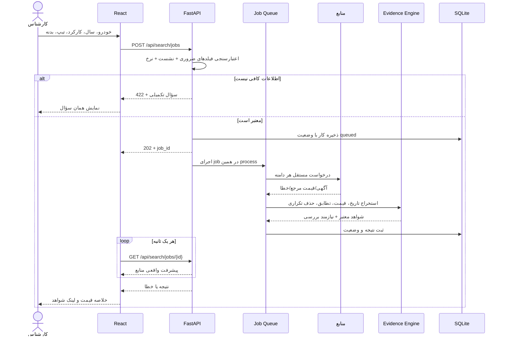
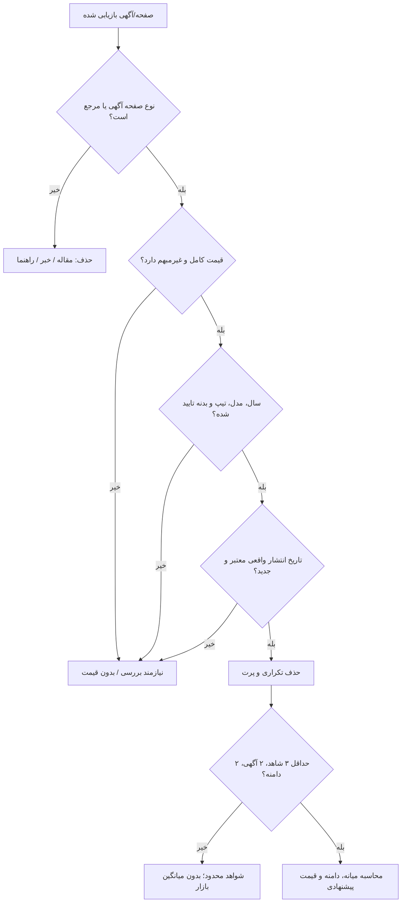

# معماری داودی کار نسخه ۲۴

## ترتیب دریافت استعلام

## مسیر تصمیم‌گیری درباره قیمت

## ساختار سرویس‌ها

- `main.py`: API، login/logout، token revocation، cache، domain scheduling، jobs/history.
- `market_parsers.py`: parsing صرفاً قاعده‌محور و محافظه‌کارانه؛ fail closed on ambiguous price.
- `market_intelligence.py`: مشخصات و اصالت شواهد، freshness، de-dup، quality score، statistics.
- `connectors/`: فقط داده عمومی، timeout، و تلاش برای metadata در JSON-LD.
- `vehicle_nlp.py`: alias + user confirmation؛ AI/LLM قیمت تولید نمی‌کند.
- `frontend/`: ورود، فرم، ابهام‌زدایی، پیشرفت واقعی، خلاصه قیمت و نمودار.

## محدودیت در چند replica

SQLite برای یک instance مناسب است. ThreadPoolExecutor «صف پایدار توزیع‌شده» نیست؛ اگر Liara instance را restart کند task در حال اجرا از دست می‌رود و خواندن کار باید timeout شود. برای مقیاس‌پذیری، Redis + RQ/Celery + Postgres و idempotency لازم است.
