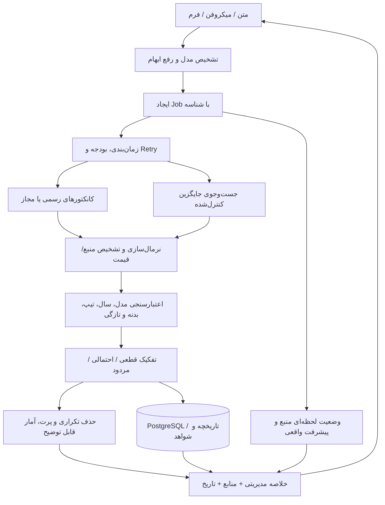

# گزارش جامع ممیزی فنی، قیمت‌گذاری و تجربه کاربری Davoodi Car v23

**تاریخ:** ۱۲ نوامبر ۲۰۲۶  
**دامنه:** سورس نسخه `23.0.0-search-qa-ux` در بک‌اند FastAPI، فرانت‌اند React، کانکتورها، Docker، مستندات و تست‌ها.  
**حکم:** نسخه ۲۳ برای آزمون آزمایشی مناسب است، اما **برای استفاده از خروجی قیمت به‌عنوان مبنای خرید و فروش واقعی آماده تأیید نیست**. چند باگ قابل بازتولید، قیمت یا مشخصات را اشتباه می‌سازند.

## روش بررسی و محدوده اعتبار

- خواندن فایل‌های واقعی `backend/main.py`، `backend/market_intelligence.py`، `backend/vehicle_nlp.py`، سه کانکتور، `frontend/src/main.jsx`، CSS و CI.
- اجرای آزمون‌های خود پروژه: **۲۱ آزمون نسخه ۲۳** و **۱۱ آزمون واحد نسخه ۲۲** موفق؛ آزمون‌های نسخه ۲۱ و **۶ سناریوی JavaScript + ۵ قرارداد UX** نیز موفق.
- اجرای آزمایش‌های مستقلی که **باگ‌های کشف‌نشده توسط تست‌های قبلی** را آشکار کردند.
- تلاش برای `npm install --offline && npm run build` ناموفق به دلیل بسته `lucide-react` موجود نبودن در کش (`ENOTCACHED`). این نتیجه **اثبات خرابی سورس نیست**، بلکه یعنی build کامل اینجا تأیید نشده است.
- آخرین GitHub Actions نسخه ۲۳، run `43230380580`، برای backend و frontend با وضعیت `failure` و Docker با `skipped` ثبت شده؛ جزئیات گام‌های اجرای آن در گزارش API موجود نبود، پس علت اصلی CI هنوز مشخص نیست.
- جست‌وجوی واقعی بازار، لیارا، کلید واقعی AvalAI، میکروفن و نمایشگر موبایل واقعی آزمایش نشده‌اند. قیمت‌های ذکرشده در آزمون‌ها **داده آزمایشی ساختگی** هستند، نه قیمت بازار.

## یافته‌های بحرانی — P0

### P0-1 — استخراج اشتباه «قیمت» از متن حاوی کارمزد
**محل:** `backend/main.py`، تابع `_price_from_text`، حدود خط 958.  
**بازتولید:** از «سانتافه ۲۰۲۵ قیمت ۵ میلیارد تومان، با کارمزد ۳۰۰ میلیون تومان» خروجی **۳۰۰٬۰۰۰٬۰۰۰ تومان** استخراج می‌شود، درحالی‌که قیمت خودرو **۵٬۰۰۰٬۰۰۰٬۰۰۰ تومان** نوشته شده است.  
**علت:** همه مبالغ صفحه جمع‌آوری و آخرین مبلغ انتخاب می‌شود؛ ارتباط مبلغ با کلمه «قیمت خودرو» سنجیده نمی‌شود.  
**اصلاح:** parser اختصاصی با برچسب معنایی (قیمت خودرو، کارمزد، پیش‌پرداخت، مالیات)، اولویت داده ساخت‌یافته معتبر منبع و رد موارد چندمبلغی مبهم؛ پوشش تست برای تومان/ریال/قسط/کارمزد/تخفیف.

### P0-2 — اشتباه گرفتن سال ۱۴۰۳ با کارکرد خودرو
**محل:** `backend/main.py`، `parse_voice`، regex کارکرد (حدود خط 536).  
**بازتولید:** «فیدلیتی مدل ۱۴۰۳ کارکرد ۵۰ هزار» → سال **۱۴۰۳**، کارکرد **۱۴۰۳ کیلومتر**؛ بیان همراه «کیلومتر» گاهی نتیجه را صحیح می‌کند. «فیتیلی پرستیژ مدل ۱۴۰۳ کارکرد ۵۰ هزار» نیز در آزمون کارکرد **۱۴۰۳** برگرداند.  
**اصلاح:** تجزیه عبارت «کارکرد ۵۰ هزار» با اولویت نزدیک‌ترین عدد **پس از** کلیدواژه کارکرد، جداکردن بازه عدد سال، پشتیبانی از «۵۰ هزار تا»، «پنجاه هزار تا»، «۵۰k»، و عدم قرض گرفتن سال برای کارکرد. تست گفتار فارسی با ۱۰۰ نمونه.

### P0-3 — مخلوط‌شدن تیپ‌های متفاوت در قیمت‌گذاری
**محل:** `backend/main.py:_normalize_result` حدود خط 1117 و `backend/market_intelligence.py:score_evidence` حدود خطوط 108–111.  
**بازتولید:** استعلام «فیدلیتی **پرایم** ۱۴۰۳» و آگهی «فیدلیتی **پرستیژ** ۱۴۰۳» درحالی‌که `row.trim=None` باشد، نمره **۷۶** می‌گیرد و **پذیرفته می‌شود**.  
**علت:** تیپ از عنوان آگهی استخراج نمی‌شود و قانون رد تیپ فقط وقتی `item.trim` موجود باشد عمل می‌کند.  
**اصلاح:** استانداردسازی تیپ/گیربکس/نسل از متن و JSON سایت، رد تعارض صریح، قرار دادن موارد با تیپ نامعلوم در گروه «نیازمند تأیید» و نه میانگین دقیق.

### P0-4 — وضعیت رنگ، بدنه و گیربکس عملاً وارد برآورد قیمت نمی‌شود
**محل:** `backend/market_intelligence.py`؛ هیچ استفاده‌ای از `vehicle.condition`, `transmission`, `color`, `body_parts` برای امتیاز/مدل قیمت وجود ندارد؛ این‌ها بیشتر در API و cache نگهداری می‌شوند.  
**پیامد:** دو خودرو با وضعیت بدنه متفاوت و باقی مشخصات یکسان، اگر همان شواهد را داشته باشند می‌توانند قیمت برآوردی یکسان بگیرند؛ این با ادعای «با در نظر گرفتن آسیب بدنه» در UI سازگار نیست.  
**اصلاح:** نخست **تطبیق و تفکیک** آگهی‌های دارای اطلاعات بدنه و گیربکس؛ فقط پس از تهیه داده معاملات معتبر، مدل تعدیل قیمت قابل کالیبراسیون طراحی شود. از درصد افت قیمت حدسی پرهیز شود.

### P0-5 — نبود محافظت در برابر حدس رمز ورود
**محل:** `backend/main.py`، `POST /api/login` حدود خط 916.  
**آزمون:** ۱۲ ورود ناموفق پشت سرهم همگی 401 برگشتند؛ هیچ 429 یا کنترل تعداد تلاش فعال نشد. محدودکننده نرخ فعلی صرفاً روی **جست‌وجو** اعمال می‌شود.  
**اصلاح:** محدودسازی ورود به‌ازای IP و حساب، وقفه افزایشی، لاگ امنیتی، کاربران جداگانه با رمز هش‌شده، نقش مدیر/کارشناس و امکان ابطال نشست. پیش از عمومی‌کردن سامانه ضروری است.

### P0-6 — خودروی کارکرده به‌اشتباه «صفر» طبقه‌بندی می‌شود
**محل:** `backend/main.py:_normalize_result` حدود خط 1113.  
**بازتولید:** عنوان «هیوندای سانتافه ۲۰۲۵ کارکرد ۵۰٬۰۰۰ **تحویل فوری**» به `is_new=True` و `mileage=50000` تبدیل شد.  
**علت:** «تحویل فوری» مترادف صفر کیلومتر محسوب شده است.  
**اصلاح:** «صفر» فقط با شواهد قابل قبول `mileage=0` یا برچسب صریح مورد تأیید؛ ناسازگاری `is_new=True` و `mileage>0` باید رد و در diagnostics ثبت شود.

## یافته‌های مهم — P1

### P1-1 — همه منابع ادعاشده واقعاً جست‌وجو نمی‌شوند
**محل:** `SOURCE_CONNECTORS` شش دامنه و `MAX_DOMAIN_REQUESTS=5` در `.env.example`؛ fallback در `main.py:1254–1305`.  
**آزمون:** وقتی کانکتورهای اولیه هیچ شاهدی ندارند، پنج دامنه با وضعیت `not_configured` گزارش شدند و **شیپور** به `not_checked` رفت. بدون کلید AvalAI، جست‌وجوی تکمیلی اصولاً فعال نیست.  
**اصلاح:** بودجه دامنه پویا و چرخشی، جست‌وجوی چندمرحله‌ای با اولویت بر اساس نرخ موفقیت، نمایش «بررسی نشد» جدا از «هیچ آگهی وجود ندارد»؛ پیکربندی واقعی برای هر منبع.

### P1-2 — حذف آگهی قدیمی در کانکتورهای داخلی قابل اتکا نیست
**محل:** `backend/connectors/bama.py` و `hamrah.py` هیچ `published_at` برنمی‌گردانند؛ `market_intelligence.py:104–107` فقط وقتی تاریخ موجود باشد حذف را انجام می‌دهد.  
**پیامد:** آگهی چندماهه با تاریخ نامشخص می‌تواند پذیرفته شود. زمان مشاهده جست‌وجو به‌جای تاریخ انتشار نباید تلقی شود.  
**اصلاح:** استخراج تاریخ قابل اعتماد از آگهی/JSON-LD/API، نمایش «تاریخ نامعلوم»، امتیاز کمتر و محدودیت استفاده از تاریخ نامعلوم برای قیمت قطعی.

### P1-3 — سال نامعلوم در آگهیِ خودرو با سال دقیق، هنوز به برآورد راه می‌یابد
**محل:** `market_intelligence.py:101–125`.  
**آزمون:** آگهی فیدلیتی پرایم بدون فیلد سال با نمره **۶۶** پذیرفته شد، درحالی‌که درخواست سال ۱۴۰۳ داشت.  
**اصلاح:** دو سطح شاهد تعریف شود: «تطبیق قطعی مدل/سال/تیپ» و «تطبیق احتمالی»؛ فقط سطح قطعی وارد برآورد دقیق شود.

### P1-4 — کش داده قدیمی در خرابی منابع ممکن است بدون سقف سنی برگردد
**محل:** `backend/main.py:1419–1442`، فراخوانی `saved(key)` بدون `age` در بلوک خطا.  
**پیامد:** یک گزارش قدیمی می‌تواند هنگام اختلال بازیابی شود. UI برچسب stale دارد ولی حداکثر مجاز عمر داده تعیین نشده است.  
**اصلاح:** TTL کوتاه برای تازه، سقف stale صریح (مثلاً ۲۴ ساعت قابل تنظیم)، نشانگر واضح زمان آخرین موفقیت؛ بعد از سقف سنی فقط «منبع در دسترس نیست» نه قیمت بازار جدید.

### P1-5 — معماری پردازش سنگین و انسداد جست‌وجو
**محل:** `backend/main.py`، `_search_semaphore = BoundedSemaphore(1)`، محدودیت ساعتی کلی ۳۰، cooldown کلی ۱۲ ثانیه، `asyncio.wait_for(asyncio.to_thread(work), 105)`.  
**ریسک:** درخواست‌های چند کاربر صف می‌شوند؛ timeout در ThreadPool لزوماً I/O جاری را متوقف نمی‌کند. پایش P95 و حداکثر درخواست هم‌زمان هنوز نیست.  
**اصلاح:** جست‌وجو به job queue با ID و progress واقعی، cancellation، timeout به‌ازای منبع، چند worker، محدودیت نرخ به‌ازای کاربر/دامنه، کش لایه‌ای و محدودیت هزینه.

### P1-6 — کیفیت منبع متکی به HTML شکننده و متن خلاصه است
**محل:** کانکتورها با `LinkParser` و selectorهای regex روی لینک‌های HTML. اگر محتوای اصلی با JavaScript تولید شود یا صفحه تغییر کند، آگهی واقعی به دست نمی‌آید.  
**اصلاح:** منبع اول API رسمی/مجاز، داده ساختاریافته JSON-LD یا endpoint عمومی مستند، بعد HTML؛ fixture واقعی و monitor نرخ موفقیت برای هر منبع. از دورزدن محدودیت یا CAPTCHA خودداری شود.

### P1-7 — CI ناموفق و build رابط تأیید نشده
**شواهد:** run GitHub Actions نسخه ۲۳ شکست خورده و Docker اجرا نشده است. npm آفلاین `lucide-react` را در cache نداشت.  
**اصلاح:** بررسی پیام دقیق run در GitHub (runner/permissions/billing/steps)، اضافه‌کردن `package-lock.json` و `npm ci`، pytest + coverage، تست React، اجرای Docker build و smoke test در CI. علت GitHub Actions را بدون log نمی‌توان حدس زد.

### P1-8 — Query سال‌های شمسی و میلادی ممکن است بیش‌ازحد محدودکننده باشد
**محل:** `main.py:_search_terms`، سال اصلی و فقط یک تبدیل ±621 در همان Query کنار هم قرار می‌گیرند؛ ممکن است آگهی‌هایی که فقط یک سال را دارند یافت نشوند.  
**اصلاح:** Queryهای جایگزین (جداگانه: اصل/معادل شمسی/نام انگلیسی/نام فارسی) با کنترل تعداد درخواست و رتبه‌بندی نتایج؛ تأیید سال در مرحله فیلتر نه وابسته‌کردن همه سال‌ها به یک Query.

### P1-9 — شواهد پذیرفته‌شده و شواهد واقعاً استفاده‌شده یکی نیستند
**محل:** `main.py:1328–1360` و `market_intelligence.py:192+`. گزارش diagnostics آگهی‌های accepted را می‌شمارد اما `price_summary` ممکن است برخی را پرت تشخیص داده و از قیمت کنار بگذارد.  
**اصلاح:** خروجی هر شاهد فیلد صریح `pricing_state` (used / rejected / outlier / limited) و دلیل داشته باشد؛ KPIها و جدول از همان شمارش یکتا ساخته شوند.

## بهبودهای تجربه کاربری — P2

- **فرایند یکپارچه:** فرم کوتاه «مدل، تیپ، سال، کارکرد»، یک سؤال هوشمند هنگام ابهام، و در گام بعدی شرایط بدنه/شهر. عدم اعلام همه فیلدها به‌عنوان نامشخص.
- **شفافیت وضعیت:** مرحله واقعی جست‌وجوی هر دامنه، تعداد آگهی‌های معتبر، زمان آخرین بررسی، دلیل رد و امکان «تلاش مجدد فقط در منبع مشکل‌دار»؛ نوار پیشرفت نمایشی بدون داده مرحله‌ای حذف شود.
- **نتیجه ساده برای مدیر:** قیمت یا «شواهد محدود»، بازه و میانه، سطح کیفیت، تاریخ/منبع، تفاوت آگهی/مرجع. نمودار در صفحه تکمیلی؛ نمایش یک قیمت بزرگ تنها وقتی نمونه کافی باشد.
- **حافظه صحیح بین جست‌وجوها:** هنگام استعلام با همان متن ولی کارکرد متفاوت، تب «صفر/کارکرده» باید با داده جدید همگام شود؛ تب فعلی فقط بار نخست با `useState` تعیین می‌شود.
- **تست موبایل واقعی و دسترس‌پذیری:** iPhone Safari و Android Chrome، میکروفن فارسی، حالت بدون اجازه میکروفن، صفحه‌کلید، اندازه لمس، VoiceOver/TalkBack، کاهش حرکت.
- **ساختار فنی frontend:** کامپوننت ۴۴٫۸هزارنویسه‌ای React و فایل CSS بزرگ با overrideهای بسیار به اجزای کوچک، لایه API، state مدیریت‌شده و سیستم طراحی تقسیم شود؛ تست Playwright و snapshot تصویری اضافه شود.
- **چندکاربره و ثبت تصمیم:** حساب‌های مجزا، تاریخچه جست‌وجو/تأیید آگهی، یادداشت کارشناسی، خروجی PDF حرفه‌ای و لینک دائمی گزارش.

## معماری هدف ارتقای مرحله‌ای

## مراحل پیشنهادی اجرای اصلاحات

**مرحله A — پیش از استفاده تجاری:** P0-1 تا P0-6 را اصلاح کنید؛ تست‌های رگرسیون دقیق اضافه کنید؛ جلوی گزارش قیمت با سال/تیپ یا قیمت نامطمئن را بگیرید؛ امنیت ورود و حداکثر سن داده را اصلاح کنید.

**مرحله B — جست‌وجوی قابل اتکا:** APIهای مجاز و کانکتورهای پایدار، تاریخ آگهی، تست زنده کنترل‌شده، coverage سنجش منابع، داشبورد سلامت، صف جست‌وجو و خطای قابل توضیح.

**مرحله C — محصول حرفه‌ای:** بازطراحی کوتاه و موبایلی، نقش‌های کاربران، PostgreSQL/ذخیره پایدار، تحلیل روند با تاریخچه واقعی، PDF، مشاهده و تأیید کارشناسی، تست‌های E2E و انتشار خودکار با rollback.

## آزمون‌های پذیرش ضروری

| سناریو | نتیجه لازم |
|---|---|
| «فیدلیتی مدل ۱۴۰۳ کارکرد ۵۰ هزار» | `mileage=50000`، نه 1403 |
| «فیدلیتی پرایم ۱۴۰۳» + آگهی «پرستیژ» | ردِ تعارض تیپ |
| «قیمت خودرو ۵ میلیارد، کارمزد ۳۰۰ میلیون» | قیمت خودرو ۵ میلیارد؛ کارمزد جدا |
| «سانتافه ۲۰۲۵ کارکرد ۵۰٬۰۰۰ تحویل فوری» | کارکرده؛ نه صفر |
| آگهی قدیمی با تاریخ مشخص | رد/علامت‌گذاری stale مطابق سیاست |
| آگهی فاقد سال در درخواست دقیق | شاهد غیرقطعی؛ خارج از قیمت پیشنهادی دقیق |
| شکست یک منبع | ادامه سایر منابع + علت خطای همان سایت |
| نبود API key | پیام واضح «جست‌وجوی تکمیلی غیرفعال» |
| ۲ آگهی قطعی | نمایش «شواهد محدود» بدون میانگین قطعی |
| ۳+ شاهدِ تأییدشده | میانه، بازه، شمارش شواهد و منابع واقعی |
| ورود با رمز غلط تکراری | محدودسازی و هشدار امنیتی |
| refresh در خطای شبکه با کش قدیمی | برچسب داده منقضی + عدم نمایش قیمت به‌عنوان امروز |
| موبایل و میکروفن | راهکار جایگزین دستی و پاسخگوی RTL |
| CI | test backend + frontend build + Docker build سبز |

## نتیجه

**مشکل اصلی نسخه ۲۳ کمبود ظاهر نیست.** برخی داده‌ها از نظر عدد، مدل، تیپ، سال، کارکرد یا «صفر/کارکرده» نادرست طبقه‌بندی می‌شوند و به قیمت نهایی راه پیدا می‌کنند. تا رفع P0ها، خروجی فقط **کمک به بررسی کارشناسی** باشد و نه مرجع خرید و فروش. اولویت صحیح: **اعتبار قیمت و مشخصات → پوشش واقعی منابع → سرعت و پایداری → UX و امکانات مدیریتی**.