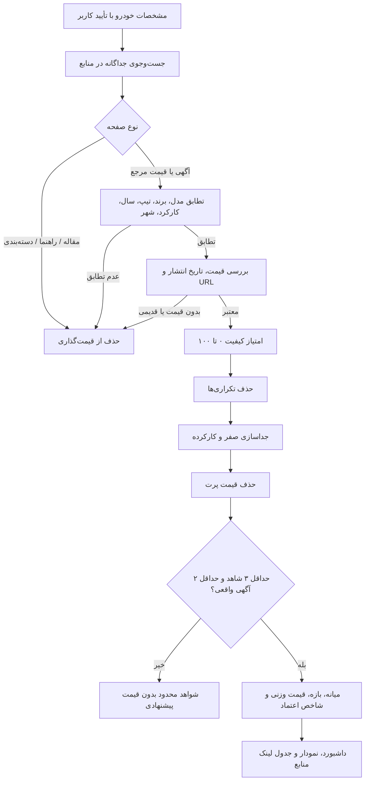

# موتور هوش بازار — نسخه ۲۲

## روش امتیازدهی (جمعاً ۱۰۰ امتیاز)

| معیار | سقف |
|---|---:|
| تطابق مدل | ۳۰ |
| تطابق برند | ۱۰ |
| سال ساخت | ۱۵ |
| تیپ | ۱۰ |
| کارکرد | ۱۰ |
| شهر | ۷ |
| تازگی آگهی | ۱۰ |
| نوع شاهد (آگهی/مرجع) | ۸ |

امتیاز فقط **شاخص کیفیت داده** است. عددی مانند ۸۲ از ۱۰۰ را نباید به معنای ۸۲٪ احتمال صحت قیمت دانست. امتیاز کیفیت با تعداد شواهد، تنوع دامنه‌ها و سهم آگهی واقعی برای سطح اعتماد «کم/متوسط/زیاد» ترکیب می‌شود.

## مراحل پردازش

## شواهد و روش قیمت‌گذاری
آگهی‌های فروش از نظر نوع شاهد بیشترین وزن را دارند. صفحات مرجع قیمت مانند قیمت کارشناسی وزن کمتر (۴۵٪) دریافت می‌کنند. مقالات، خبرها و مشخصات فنی صرفاً اطلاعاتی هستند و بر قیمت اثر ندارند. قیمت پرت با MAD و آستانه نسبی حذف می‌شود و عدد نهایی از داده‌های صریح موجود استخراج می‌گردد؛ هیچ قیمت توسط مدل زبانی تولید نمی‌شود.

بازه پیشنهادی (suggested_min/suggested_max) از چارک‌های قیمت‌های پذیرفته‌شده ساخته می‌شود؛ دامنه کامل نمونه نیز در price_min/price_max در دسترس است. بازه، «محدوده شواهد فعلی» است و تضمین قیمت معامله نیست.

## منشأ زمانی
`published_at` زمان انتشار آگهی است؛ `observed_at` یا زمان جست‌وجو نباید به‌عنوان زمان انتشار جعل شود. اگر آگهی زمان انتشار قابل اعتماد ندارد، قدمت نامعلوم است و امتیاز تازگی پایین‌تر می‌ماند. آگهی‌های دارای تاریخ معتبر قدیمی‌تر از پیش‌فرض ۶۰ روز حذف می‌شوند.

## NLP و اصلاح گفتار
`vehicle_nlp.py` نام‌های رایج، تلفظ‌های نادرست و معادل‌های انگلیسی را مدیریت می‌کند و برای تطابق فازی نامطمئن **فقط پیشنهاد** می‌دهد، نه تشخیص قطعی. «سانتافه نیوفیس» در `generation` ثبت می‌شود، نه تیپ ساختگی. برای فیدلیتی بدون تیپ، فقط سؤال «پرایم/پرستیژ/الیت» مطرح می‌شود. تیپ، سال و کارکردِ گفته‌نشده حدس زده نمی‌شوند.

## فرانت‌اند
بخش Summary بالای کارت‌های نتایج قرار گرفته و انتخاب گروه «صفر / کارکرده»، قیمت پیشنهادی (در صورت شواهد کافی)، میانه، تعداد آگهی و مرجع، تعداد سایت، امتیاز اطمینان، جدول لینک شواهد و هیستوگرام قیمت را نمایش می‌دهد. تمام اعداد از API برمی‌آیند.

## آزمون و محدودیت
`cd backend && python test_v22_intelligence.py` تست‌های ثابت و آفلاین را اجرا می‌کند. این آزمون‌ها اتصال به سایت‌های واقعی یا ساخت Docker را اثبات نمی‌کنند. نصب npm در محیط ایجاد بسته ممکن نشد؛ باید در Liara پس از build بررسی شود.
