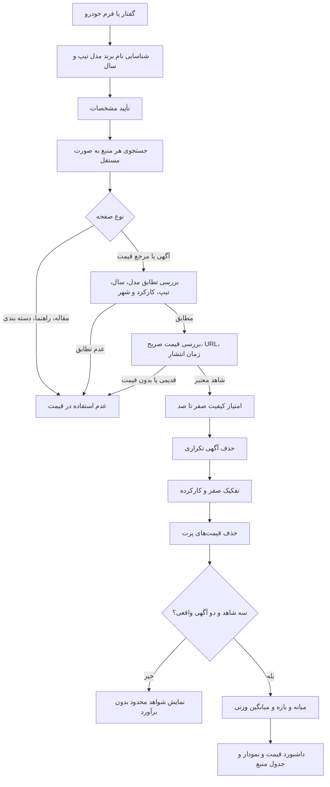

# Davoodi Car v22 — موتور هوش بازار خودرو

**تاریخ:** ۱۲ نوامبر ۲۰۲۶

## امکانات پیاده‌سازی‌شده در بسته ZIP نسخه ۲۲
- امتیاز کیفیت تک‌تک شواهد از ۰ تا ۱۰۰ (نه احتمال آماری صحت).
- تطابق مدل (۳۰)، برند (۱۰)، سال (۱۵)، تیپ (۱۰)، کارکرد (۱۰)، شهر (۷)، تازگی انتشار (۱۰)، نوع شاهد (۸).
- آگهی فروش وزن کامل، مرجع قیمت وزن ۴۵٪، مقاله و مشخصات فنی وزن صفر در قیمت‌گذاری.
- حذف لینک‌های یکسان حتی با UTM، موارد بازنشر تکراری، آگهی‌های دارای تاریخ انتشار قدیمی‌تر از ۶۰ روز، قیمت پرت، و آگهی نامرتبط.
- حفظ عدم قطعیت: در نبود زمان انتشارِ قابل اعتماد، «تاریخ نامعلوم» فرض می‌شود نه «آگهی جدید».
- حداقل ۳ شاهد با **حداقل ۲ آگهی واقعی** برای اعلام برآورد؛ در غیر این صورت «شواهد محدود» بدون قیمت پیشنهادی.
- محاسبه قیمت میانگین وزنی، میانه، حداقل/حداکثر مشاهده‌شده، بازه پیشنهادی مبتنی بر چارک‌ها، تعداد آگهی/مرجع/دامنه و امتیاز کیفیت.
- NLP فارسی با نام‌های جایگزین، پیشنهاد تأییدی برای حدس فازی، تشخیص «فیدلیتی» و «سانتافه نیوفیس ۲۰۲۵».
- داشبورد مدیریتی واکنش‌گرا: خلاصه قیمت، جدول لینک شواهد معتبر، هیستوگرام، انتخاب صفر/کارکرده.

## دیاگرام اعتبارسنجی

## وزن‌دهی و سطح اطمینان
- `quality_score`: شاخص تطابق/تازگی/نوع شاهد، ۰ تا ۱۰۰.
- `confidence_score`: شاخص پوشش داده و اعتبار شواهد، **نه احتمال صحت قیمت**.
- `confidence`: کم، متوسط یا زیاد، براساس امتیاز و کف نمونه.
- `outliers_removed`، `histogram`، `domain_count` و `listing_count` برای قابلیت بررسی خروجی.

## ساختار سورس در بسته
- `backend/market_intelligence.py`: امتیازدهی، حذف تکراری، آمار شواهد و نمودار
- `backend/vehicle_nlp.py`: معادل نام‌ها، تطبیق گفتار و پیشنهاد مدل
- `backend/main.py`: اتصال موتور به API موجود و تشخیص گفتار
- `backend/test_v22_intelligence.py`: آزمون‌های آفلاین
- `frontend/src/main.jsx` و `frontend/src/style.css`: داشبورد مدیریتی

## آزمایش و استقرار
در محیط توسعه `python test_v22_intelligence.py` با ۱۱ تست آفلاین و تست قدیمی v21 موفق بود؛ فایل JSX توسط parser TypeScript بررسی شد. **ساخت واقعی Docker، نصب npm و استقرار زنده در Liara در این محیط تأیید نشده‌اند**. عملکرد سایت‌های زنده نیز جداگانه باید آزمایش شود.

متغیر اختیاری جدید `MAX_LISTING_AGE_DAYS=60` است. `ADMIN_PASSWORD` و `SESSION_SECRET` را فقط در تنظیمات امن Liara نگهداری کنید. `DB_PATH` باید به فضای پایدار اشاره کند.
