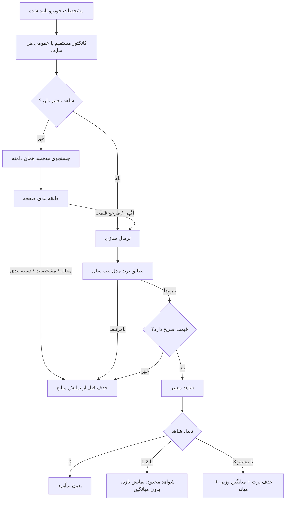

# معماری موتور منبع بازار — v21

این سند جریان جدید جمع‌آوری و اعتبارسنجی قیمت را نشان می‌دهد.

## وضعیت منبع
- **نتیجه خام**: خروجی کانکتور یا جست‌وجوی هدفمند همان سایت.
- **شاهد معتبر**: صفحه‌ای که نوع آن معتبر، خودروی آن مرتبط و قیمت آن صریح باشد.
- مقاله، مشخصات فنی، راهنما، خبر و صفحه دسته‌بندی به‌عنوان شاهد قیمت استفاده نمی‌شوند.
