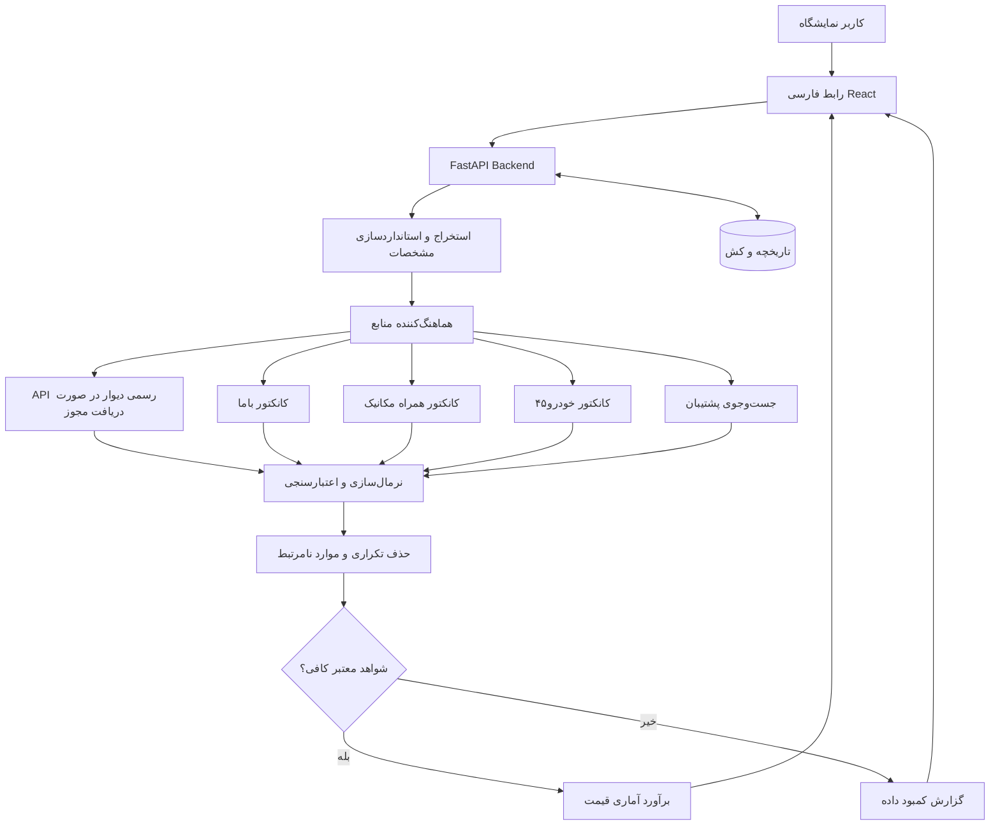
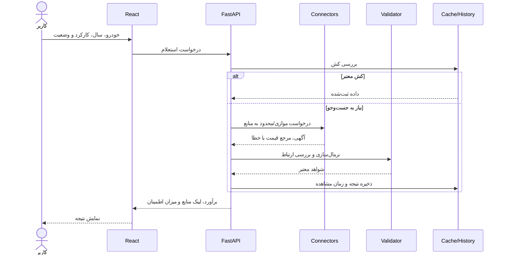
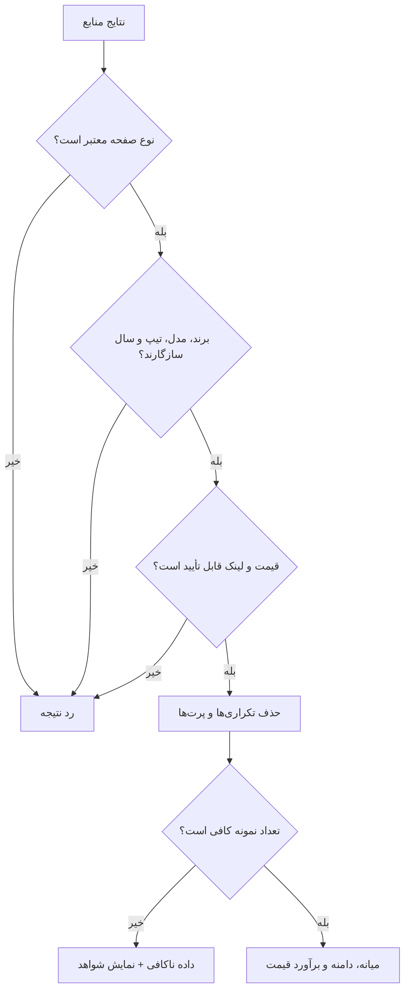
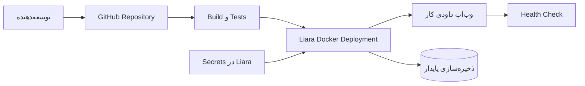

# دیاگرام‌های سامانه داودی کار

دیاگرام‌ها با Mermaid نوشته شده‌اند و در GitHub به‌صورت تصویری نمایش داده می‌شوند. آن‌ها **معماری هدف** را نشان می‌دهند، نه تضمین تکمیل همه اجزا.

## ۱. نمای کلان

## ۲. جریان یک استعلام

## ۳. تصمیم‌گیری قیمت

## ۴. استقرار

